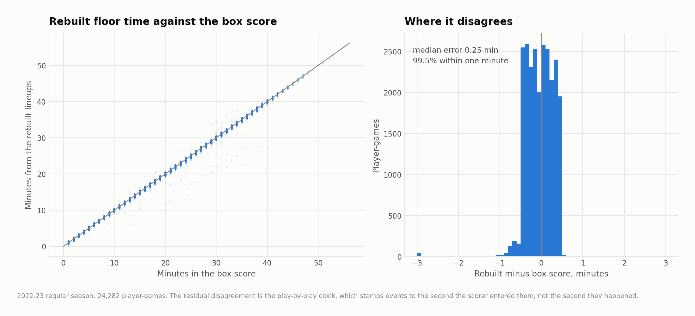
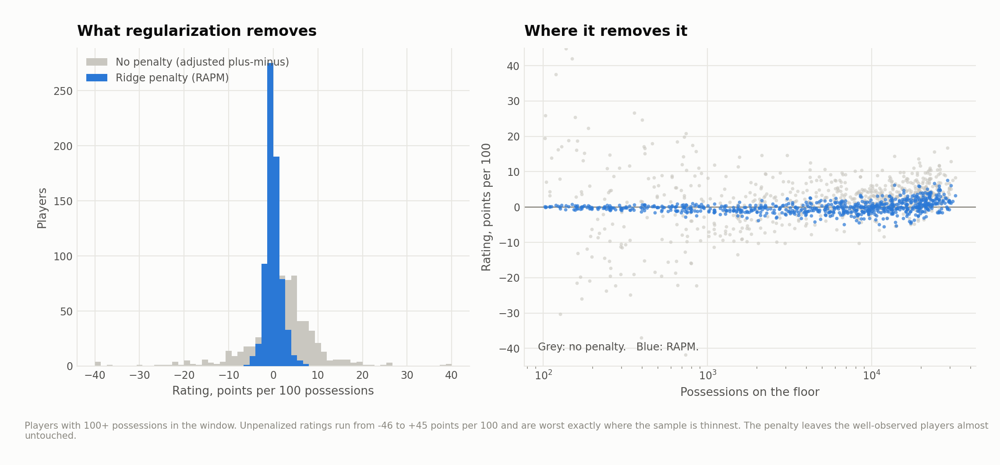
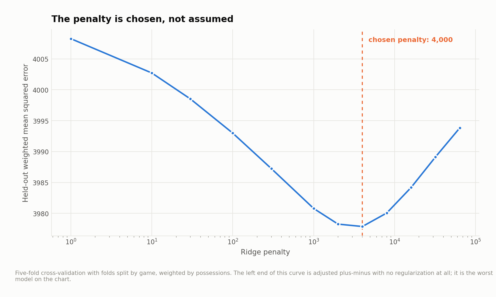
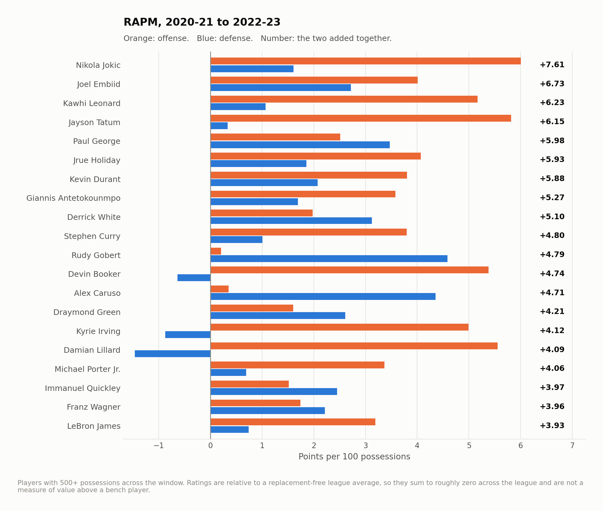
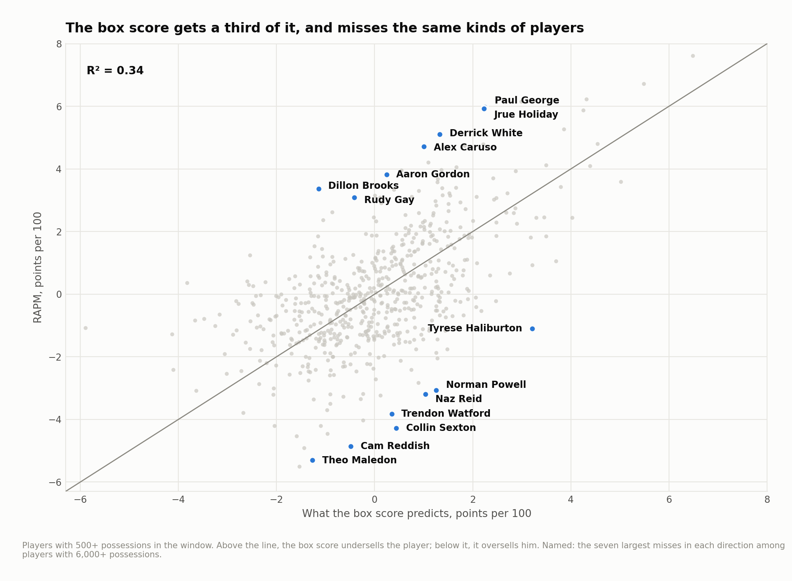
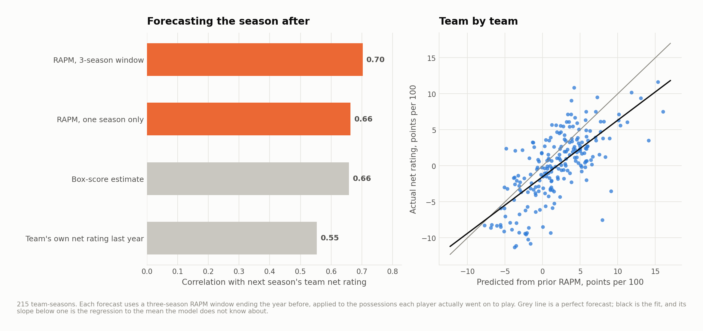

# RAPM, built from the log up

Regularized adjusted plus-minus for the NBA, starting from raw play-by-play
rather than a lineup feed — which means the hard part is not the regression. It
is knowing who was on the floor.

Ten seasons, 2013-14 through 2022-23. **11,145 games rebuilt out of 11,913
(93.6%), 611,058 stints, 2.15 million possessions.**

---

## The part that is actually hard

Play-by-play records substitutions. It never records a lineup. To get one you
replay the game — start each period with the right five and apply every
substitution in order — and the trouble is that periods two, three and four have
no equivalent of a box score's starters column.

The inference is exact whenever the log is complete: a player was on the floor at
the start of a period if, during that period, he did *anything* — took a shot,
grabbed a rebound, committed a foul, got subbed out — before he ever entered the
game. Comparing each player's first substitution *in* against his first
appearance in any other event resolves the starting five for a period without
guessing.

Then it gets checked. Every player's reconstructed floor time, against his box
score minutes, for the whole 2022-23 season:



**Median absolute error 0.25 minutes. 99.5% of player-games within one minute.
Correlation 0.99919** across 24,282 player-games. Most of the residual
disagreement looks like the play-by-play clock, which stamps events when the
scorer entered them rather than the second they happened.

Games that fail — a period that will not resolve to five a side, or floor time
that disagrees with the box score by more than the thresholds in `config.py` —
are dropped and counted, not repaired. `output/reconstruction_audit.csv` has the
per-season figures. The keep rate is above 97% in seven of ten seasons and falls
to 80-85% in 2017-18 through 2019-20, where the source feed has thinner
substitution logging. A lineup that is silently wrong is far worse than one that
is missing.

---

## Why the penalty is not optional

Adjusted plus-minus is a regression of what happened on who was out there. It is
the right idea and, run as plain least squares, it does not work at all.

Teammates share almost all of their minutes, so the design matrix is close to
singular and least squares answers with enormous, unstable numbers. Among players
with 100 to 400 possessions in the window, unregularized ratings have a standard
deviation of **18.7 points per 100** and run from −46 to +45. Those are not
findings; they are the model reporting that it cannot tell two players apart, in
the loudest possible way.



Ridge fixes it by refusing to make a large claim on thin evidence. The same
players come out with a standard deviation of **0.4**. Players the data can
actually see are barely touched.

The penalty is chosen, not assumed — five-fold cross-validation with folds split
by game, weighted by possessions:



And the left end of that curve is worth saying out loud. On held-out games:

| Model | Weighted MSE |
|---|---|
| League average | 4,012.8 |
| Team offense and defense only | 4,004.5 |
| **Adjusted plus-minus, no penalty** | **4,016.7** |
| RAPM | **3,984.3** |


Unregularized adjusted plus-minus is worse than a model that knows nothing about
the ten players on the floor beyond which two teams they play for. RAPM is the
only specification here that beats knowing the team name.

(The R² values behind those numbers are tiny — 0.007 for RAPM — and that is
correct. One stint is three or four possessions. Almost all of its scoring is
noise. The comparison between models is the whole content; the absolute fit is
not supposed to be impressive and any plus-minus model that fits a single stint
well is fitting something it should not be.)

---

## The ratings

Three seasons pooled, 2020-21 through 2022-23: 188,329 stint-sides, 3,436 games,
673,655 possessions, 781 players, penalty 4,000.



Two sanity checks a reader can make without trusting any of the above. The model
is given no information about home court beyond an indicator column, and it
estimates it at **+1.72 points per 100**, which is where independent estimates
for those seasons land. And the top of the defensive list is Rudy Gobert (+4.58),
Alex Caruso (+4.36), Paul George (+3.47), Jusuf Nurkić, Derrick White, Matisse
Thybulle, Anthony Davis. Nothing in the pipeline knows what a block is.

Ratings are relative to league average, not to a replacement player, so they sum
to roughly zero across the league. A +5 is a player who makes his team five
points per 100 better than an average one, which is not the same as five points
better than the guy who would take his minutes.

---

## What the box score can and cannot see

Regressing RAPM on per-100 box rates:

**R² = 0.338** across 627 players with 500+ possessions in the window. Two
thirds of the variance in a player's plus-minus impact is not in his counting
stats.

The coefficients are worth reading, in units of a one standard deviation change:

| | Effect on RAPM |
|---|---|
| Points | **+6.28** |
| Field goals made | **−2.47** |
| Shot attempts | **−2.09** |
| Free throw attempts | −1.24 |
| Assists | +0.78 |
| Turnovers | −0.61 |
| Steals | +0.50 |
| Defensive rebounds | +0.34 |
| Blocks | +0.18 |

Points enter strongly positive while makes and attempts enter negative, which is
the same statement made twice: what the model rewards is points *net of the
possessions used to get them*. Scoring efficiently helps. Scoring a lot does not,
on its own. And the two stats that get quoted as defensive evidence — steals and
blocks — carry almost none of the defensive signal, which is exactly why the
defensive leaderboard above looks nothing like a blocks leaderboard.



The players furthest above the line are the ones every front office already
argues about: Derrick White, Paul George, Alex Caruso, Jrue Holiday, Aaron
Gordon, Dillon Brooks. Point-of-attack defenders and connective players, whose
contribution is a shot the other team did not get.

---

## Does any of it predict anything

The test that matters. For each anchor season, ratings are built from a
three-season window and used to forecast the *following* season's team net
rating, weighting each player by the possessions he actually went on to play.
Nothing in the forecast uses data from the season being forecast except which
players ended up on which roster.

| Forecast built from | Correlation with next season's net rating |
|---|---|
| **RAPM, three-season window** | **0.70** |
| RAPM, one season only | 0.66 |
| Box-score estimate, same window | 0.66 |
| The team's own net rating last year | 0.55 |

215 team-seasons.



Three things fall out of that table. Player ratings beat team results, which is
the case for doing any of this. The three-season window beats one season, which
is why the headline model pools three and why a single season of RAPM should be
read with a wide error bar. And the box-score estimate is close behind — a public
model built only from counting stats gets most of the way there, so the honest
claim for RAPM is a real but modest edge, not a different category of knowledge.

---

## What this does not do

- **No prior, no aging curve, no multi-year weighting.** This is plain ridge on a
  stint matrix. Production systems (RPM, EPM, LEBRON) add a box-score prior, age
  adjustment and decayed weighting by recency, all of which help. Leaving them out
  keeps the estimator legible and the comparison against the box score honest.
- **No error bars on individual ratings.** Ridge coefficients have a sampling
  distribution and I have not bootstrapped it. Read the gap between two adjacent
  players as noise unless it is large.
- **Possessions are counted, not estimated**, from the log — but the count depends
  on the log being complete, and the three seasons with weaker substitution
  logging are also the ones where possession counts will be least reliable.
- **A possession is credited to the stint it began in.** A trip that spans a
  substitution is attributed entirely to the five who started it.
- **Regular season only**, and **2022-23 is the last season**, which is where the
  public play-by-play mirror this reads currently ends.
- **Garbage time is included.** Filtering it is defensible and I did not do it,
  partly because every threshold is arbitrary and partly because the possession
  weighting already makes blowout minutes cheap.

---

## Running it

```bash
pip install -r requirements.txt
python src/run_01_stints.py      # play-by-play -> stints with lineups  (~8 min)
python src/run_02_rapm.py        # cross-validated ridge, figures 01-03
python src/run_03_validate.py    # reconstruction check + held-out test, figures 04-05
python src/run_04_boxscore.py    # box-score model and forecast, figures 06-07
```

Or `make all`. Stage 1 is the slow one; everything after it reads cached stints.

```
src/
  config.py           paths, seasons, the reconstruction thresholds
  lineups.py          replaying a game to recover who was on the floor
  possessions.py      counting possessions from the log, not estimating them
  rapm.py             the sparse design matrix and the ridge fit
  labels.py           collision-resolving point labels for the scatterplots
  style.py            one place that decides what every figure looks like
  run_0*.py           the pipeline, in order
output/               every number quoted above, as CSV
figures/              seven figures, regenerated from scratch by the pipeline
docs/method.md        longer notes, including the reconstruction rules in full
```

## Data

Play-by-play and box scores from
[sportsdataverse/hoopR-data](https://github.com/sportsdataverse/hoopR-data),
a mirror of ESPN's public feeds. `data/README.md` has the fetch step.

## License

MIT. See `LICENSE`.
