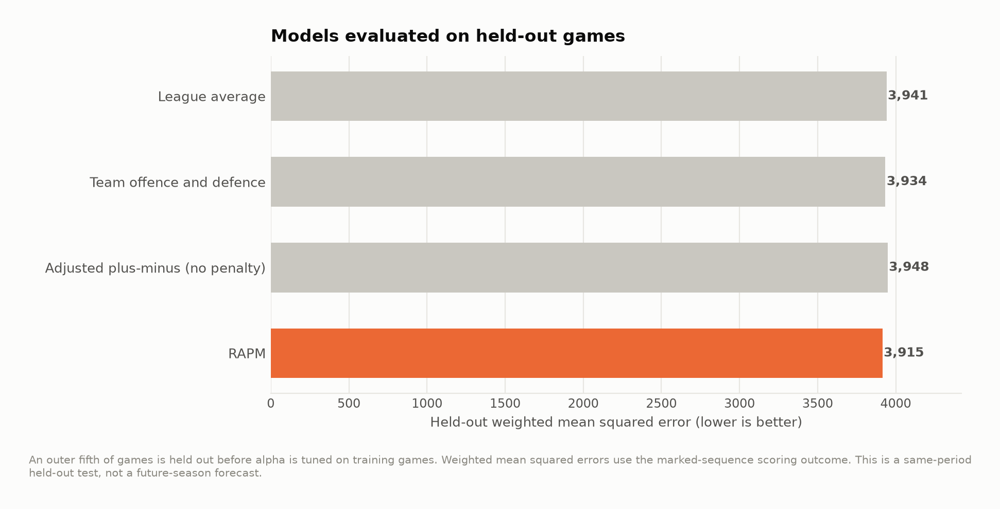

# Method and revision notes

This project rebuilds lineups from public play-by-play and fits regularized offensive and defensive player effects. It is a methods demonstration using **marked offensive sequences**, an approximation to possessions. Its ratings should not be presented as certified NBA RAPM or a definitive player ranking.

## Reconstruction and scoring checks

[Result table](../output/reconstruction_audit.csv)

The source feed assigns zero `score_value` to many made free throws in older seasons. The corrected pipeline assigns one point to a marked made free throw and requires team totals to match the box score. The parser resets sequence IDs at period boundaries. Technical and other identified retained-ball free throws do not switch possession markers; their points are excluded from the modeled ordinary-scoring outcome and counted separately. Kept games reconcile recorded points to box scores and modeled points to the retained scoring events. Exhibition games are excluded.

Lineups must meet the published average and worst-player minute-error thresholds. Agreement in total minutes does not prove the lineup at every event is correct. Ambiguous jump balls and incomplete logs can still merge sequences. Credit goes to the lineup at the start of the marked sequence, which is a modeling convention when substitutions occur during a trip.

## A separate held-out test

[Result table](../output/out_of_sample.csv)

The outer test games are chosen first. Ridge tuning uses only the remaining training games; the split and training cross-validation scores are saved. A random held-out game from the same period measures a different task from forecasting a future season.

## Prior-season carry-over baseline

[Result table](../output/forecast_correlations.csv)

For each forecast year, player ratings, tuning, team assignments and usage weights come from earlier seasons. The target season is used only for evaluation outcomes. This carry-over baseline deliberately cannot anticipate trades, injuries or new rotations. It is not a roster-aware preseason projection.

Box-score numerators are restricted to the same reconstructed games as their denominators. The published rates account for exposure being counted on both offense and defense.

## What is worth publishing

The useful contribution is the reconstruction audit, regularization comparison and separation of training from evaluation. Player coefficients remain conditional associations affected by teammates, omitted context, missing games and the sequence approximation. Before using the rankings for basketball decisions, replace the proxy with a possession parser validated against independent event annotations and evaluate sensitivity to game exclusions.

This study ends in 2022–23. It contains no current player projection.

The result tables are linked and rendered in the main article. Full algorithms and thresholds are in `src/`; source bytes are recorded in `data/source_manifest.json`.
